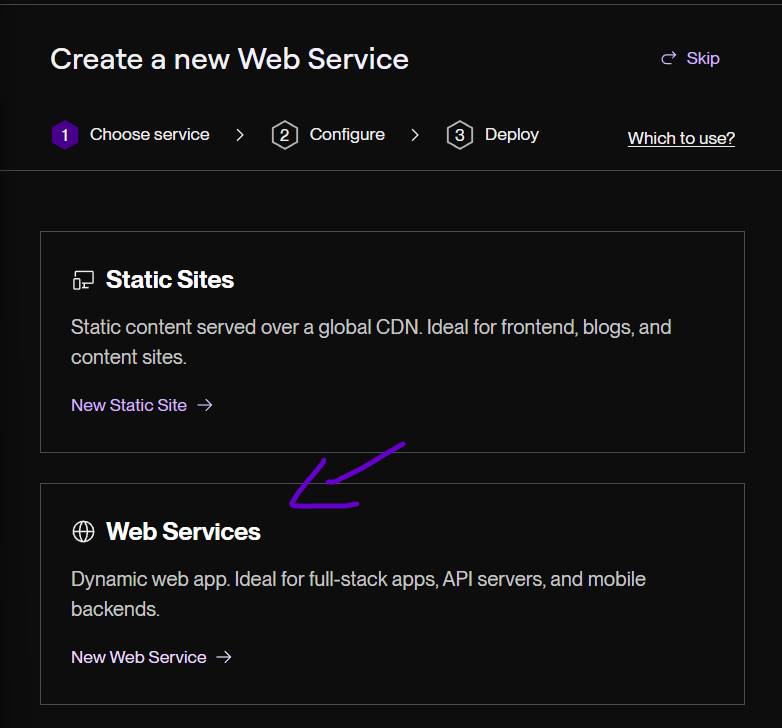
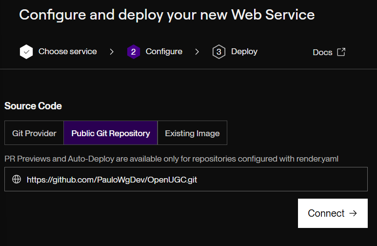

# Host OpenUGC with Render

In this guide, you'll learn how to host the **OpenUGC API** on Render, link the repository, and configure the required environment variables.
It's one of the fastest ways to get OpenUGC up and running with a public URL.

Before starting, you should have:

- A PostgreSQL database and its connection details ([Host Database with Render](./host-database.md)).
- A Google Cloud Storage bucket and its JSON key ([Host with Google Cloud Storage](./host-storage.md)).

---

### 1. Create a New Web Service

From the Render dashboard, click on **"New +" → "Web Service"**.



---

### 2. Link the Repository

Paste the following repository URL into the **Public Git Repository** field: `https://github.com/PauloWgDev/OpenUGC.git`

If you made your own fork with changes, connect your GitHub account and pick your fork instead.



---

### 3. Configure the Service

Fill in the fields as follows:

- **Language**: Docker (Render builds the image with the `Dockerfile` in the repository)
- **Branch**: `master`
- **Region**: the same region as your database
- **Root Directory**: leave empty
- **Instance Type**: Free (to try it out) or a paid plan
- **Environment Variables**: configure them in the next step

---

### 4. Set Up the Environment Variables

OpenUGC reads its settings from environment variables. Add these in the **Environment** section:

| Variable | Value |
|----------|-------|
| `DATABASE_PROFILE` | `postgres` (the only supported value for now) |
| `DATABASE_URL` | JDBC URL of your database, e.g. `jdbc:postgresql://dpg-xxxxx-a:5432/openugc_db`. See [Get the Connection Details](./host-database.md#4-get-the-connection-details) |
| `DATABASE_USERNAME` | database username |
| `DATABASE_PASSWORD` | database password |
| `JWT_SECRET` | secret used to sign tokens, at least 32 bytes. Generate one with `openssl rand -base64 48`. The API refuses to start with a short value or with `CHANGE_ME` |
| `STORAGE_TYPE` | `cloud` |
| `CLOUD_BUCKET` | your bucket name, e.g. `openugc-bucket` |
| `GOOGLE_APPLICATION_CREDENTIALS` | `/etc/secrets/<name-of-your-key-file>.json` (see below) |

You don't need to set `PORT`. Render sets it for you and OpenUGC uses it automatically.

**The Google key file.** In the same **Environment** section, add a **Secret File**. Use the name of your JSON key file (for example `openugc-key.json`) and paste its contents. Render makes it available at `/etc/secrets/openugc-key.json`, so that's the path to use in `GOOGLE_APPLICATION_CREDENTIALS`.

There are more optional settings, such as guest access and CORS for WebGL builds. They are all on the [Configuration](../configuration.md) page.

:::caution Don't use local storage on the free plan
You could set `STORAGE_TYPE` to `local`, but the free plan's disk is temporary: every uploaded file would be lost when the service restarts, redeploys or goes to sleep. The content would still be listed, but its downloads would fail.
:::

---

### 5. Health Check (Optional)

In the service settings, set the **Health Check Path** to:

```
/actuator/health
```

Render then waits until the API is really ready before sending traffic to a new deploy.

---

### 6. Deploy

After saving your settings, Render builds and deploys OpenUGC. The first build takes a few minutes.

Once it's finished, you'll have a public URL like `https://openugc-xxxx.onrender.com`. Check that it works by opening:

```
https://openugc-xxxx.onrender.com/actuator/health
```

If the response contains `"status":"UP"`, the API is live. To try the endpoints, use the same requests as in [Testing the API](../self-host-setup/host-api.md#5-testing-the-api), changing `http://localhost:8080` to your Render URL.

:::note
Free web services on Render go to sleep after 15 minutes without traffic, and the next request takes around a minute to wake them up. Your game should be ready for a slow first response, or you can use a paid instance.
:::

---

### Next Steps

- [Create the first admin account](../first-admin.md).
- Read [API Basics](../../documentation/api-basics.md) to start using the API from your game.
